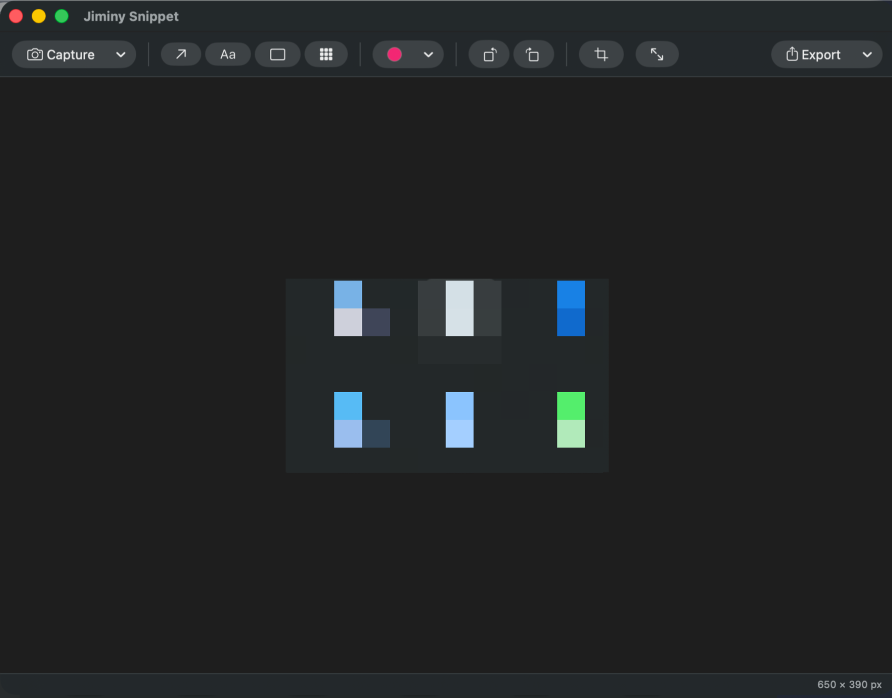
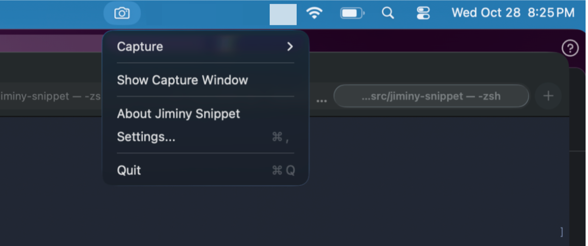

# Jiminy Snippet

A lightweight screenshot and annotation tool for macOS that lives in your menu bar.

You take a screenshot, mark it up with arrows, text, boxes, or pixelation, and then copy it, save it, or drag it straight into another app.

> **Note:** Jiminy Snippet is a vibe coded project. It was built almost entirely by pair-programming with an AI coding assistant.



## Features

### Menu bar app

Jiminy Snippet runs quietly in the menu bar. You can start a capture, open the editor window, or change settings from there without switching apps. It shows up in the Dock and the ⌘-Tab switcher only while the editor window is open.



### Capture modes

- **Whole screen**: captures the entire display.
- **Screen region**: drag out a rectangle to capture just that area.
- **Screen region with delay**: select a region, then capture it after a 3, 5 or 10 second countdown. The countdown gives you time to open menus or hover states before the shot is taken.
- **Clipboard**: annotate an image that's already on the clipboard (⌘V).

### Annotation tools

- **Arrow**: arrows you can drag to move, and drag by either end to reposition.
- **Text**: text labels you can edit, move, scale and rotate.
- **Rectangle**: outlined or filled boxes you can move, resize and rotate.
- **Pixelate**: redacts part of the image. This is applied permanently to the image pixels, so the hidden content can't be recovered from the exported file.
- **Color palette**: a nine-color palette shared by all annotation tools.

All annotations stay editable until you export. You can click to select an annotation, Shift-click or drag a marquee to select several, and press ⌘D to duplicate. Hold Shift while rotating to snap to 45° steps.

### Image editing

- **Rotate** the image clockwise or counter-clockwise.
- **Crop** to a selected area.
- **Resize** to exact pixel dimensions, with optional aspect-ratio lock.
- **Zoom** in and out (⌘= / ⌘-), zoom to fit (⌘0), zoom to actual size, or pinch to zoom on a trackpad.
- **Undo and redo** for every edit (⌘Z / ⇧⌘Z).

The image's current pixel dimensions are shown in the window's status bar.

### Export

- **Save** / **Save As…** to a PNG (⌘S / ⇧⌘S). A confirmation toast links to the file in Finder.
- **Copy to Clipboard** (⇧⌘C) to paste the annotated image anywhere.
- **Drag out**: Option-drag from the image to drop it into Finder, Slack, Mail, or any other app that accepts images.

### Settings

- Launch on sign in
- Show the capture window on startup
- Include Jiminy Snippet's own windows in screenshots (useful for capturing the app itself)

## Requirements

- macOS 15.6 or later
- Xcode 26 or later to build
- **Screen Recording** permission. macOS asks for this the first time you capture, and you can manage it under *System Settings › Privacy & Security › Screen & System Audio Recording*.

## Building

Open `jiminy-snippet.xcodeproj` in Xcode and run the `jiminy-snippet` scheme, or build from the command line:

```sh
xcodebuild -project jiminy-snippet.xcodeproj \
           -scheme jiminy-snippet \
           -configuration Release \
           -derivedDataPath build \
           build
```

The built app will be at `build/Build/Products/Release/jiminy-snippet.app`.

To run the unit tests:

```sh
xcodebuild -project jiminy-snippet.xcodeproj -scheme jiminy-snippet test
```

## Project layout

| Path | Contents |
| --- | --- |
| `jiminy-snippet/` | App source (SwiftUI + AppKit, ScreenCaptureKit for capture) |
| `jiminy-snippetTests/` | Unit tests for the document model, geometry, hit testing, undo, and export |
| `jiminy-snippetUITests/` | UI test scaffolding |
| `screenshots/` | Images used in this README |

## License

© 2026 Tom Lee.

Jiminy Snippet is free software: you can redistribute it and/or modify it under the terms of the [GNU General Public License](https://www.gnu.org/licenses/gpl-3.0.html) as published by the Free Software Foundation, either version 3 of the License, or (at your option) any later version. See [LICENSE](LICENSE) for the full text.
